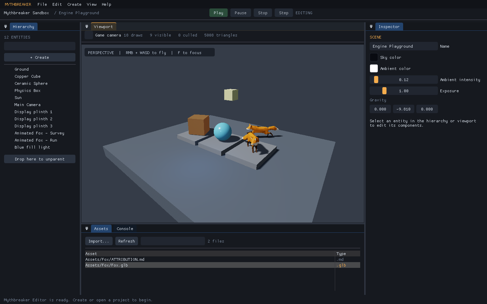

# Mythbreaker Engine

Mythbreaker is a native **C++20 / Vulkan 3D game engine** with a scene editor, a standalone player, and command-line project tools. You can create a project, assemble scenes, import models and audio, attach native game behaviours, test the result, and package it as a runnable desktop game.



The main application is now **MythbreakerEditor**. The original RPG prototype is preserved as an optional example; its combat, quest, terrain, and inventory systems are separate from the new engine workflow.

| Application | Purpose |
| --- | --- |
| `MythbreakerEditor` | Docked authoring workspace: hierarchy, components, viewport, assets, console, and play controls. |
| `MythbreakerRuntime` | Runs a project's startup scene without editor panels. |
| `MythbreakerCLI` | Creates, validates, imports, simulates, exports, and packages projects from a terminal. |

Read the [Engine Guide](docs/ENGINE_GUIDE.md) for the full workflow, controls, C++ extension examples, and troubleshooting.

## What you can build with it

- **Persistent projects and scenes.** Versioned JSON, stable entity IDs, parent-child transforms, subtree duplication, atomic saves, and project-relative asset references.
- **Interactive scene authoring.** Primitive creation, mesh picking, a translation gizmo, camera navigation, component inspectors, undo/redo, and unsaved-change protection.
- **A separate play world.** Play clones the authored scene; Pause and Step inspect the simulation; Stop restores authoring data.
- **A Vulkan renderer.** Textured meshes, scalar metallic/roughness materials, a directional light with shadows, up to eight point lights, exposure, and frustum culling.
- **Model and animation import.** glTF 2.0 / GLB and OBJ, asset dependency copying, glTF node animation and skeletal skinning evaluated on the CPU, and per-entity clip controls.
- **Runtime systems.** A 60 Hz update loop, translation-based box physics, native C++ behaviours, and spatial audio sources.
- **Standalone delivery.** Export the saved project together with the compiled player, shaders, adjacent runtime libraries, and a launcher.

This is a working, deliberately scoped engine foundation. The [current limitations](#current-scope) describe what still needs to be built for larger productions.

## Build and launch

### Requirements

- A C++20 compiler and CMake **3.20+**. The optional Ninja presets require CMake **3.21+**.
- For the desktop editor/player: Vulkan headers and loader, a Vulkan **1.2** capable graphics driver, and either `glslc` or `glslangValidator` on `PATH` or in the Vulkan SDK.
- On Linux, the X11 development libraries required by GLFW. The default build uses its X11 backend.
- Ninja if you choose the Ninja commands or presets below.

GLFW, Dear ImGui, GLM, JSON, model loaders, image loading, Vulkan Memory Allocator, and miniaudio are included in `third_party`. CMake compiles the engine shaders automatically. Windows and Linux are the desktop targets; a macOS port is not configured or validated.

### Windows — Visual Studio 2022

Install the **Desktop development with C++** workload and a Vulkan SDK, then run:

```powershell
git clone https://github.com/1sitm3n/Mythbreaker.git
cd Mythbreaker
cmake -S . -B out/build -G "Visual Studio 17 2022" -A x64
cmake --build out/build --config Release --parallel
ctest --test-dir out/build -C Release --output-on-failure
.\out\build\bin\Release\MythbreakerEditor.exe
```

### Linux — Ninja

With a C++20 compiler, Vulkan development files, a shader compiler, Ninja, and GLFW's X11 dependencies installed:

```sh
git clone https://github.com/1sitm3n/Mythbreaker.git
cd Mythbreaker
cmake -S . -B out/build -G Ninja -DCMAKE_BUILD_TYPE=Release
cmake --build out/build --parallel
ctest --test-dir out/build --output-on-failure
./out/build/bin/MythbreakerEditor
```

Alternatively, on either platform with Ninja and a configured compiler environment:

```sh
cmake --preset desktop
cmake --build --preset desktop
ctest --preset desktop
```

The desktop preset writes to `out/desktop`; its executables are in `out/desktop/bin`.

### Headless tools and tests

The core and CLI work without Vulkan, a display server, or an audio device:

```sh
cmake -S . -B out/headless -DMYTHBREAKER_BUILD_DESKTOP=OFF -DCMAKE_BUILD_TYPE=Release
cmake --build out/headless --parallel
ctest --test-dir out/headless --output-on-failure
./out/headless/bin/MythbreakerCLI --help
```

The `headless` Ninja preset provides the same target selection with a Debug build. Visual Studio generators place executables in a configuration subdirectory such as `bin/Release` and require `--config Release` when building.

## Your first project

Launching the editor without arguments opens the bundled Sandbox project. It contains a lit scene, two independently animated fox instances, a spinning cube, a falling physics box, a pulsing fill light, and a controllable primary camera. Use **File → New project** to create your own project in a new or empty directory outside the build tree.

1. Choose **Create → Cube**, select it in the hierarchy, and change its transform or material in the Inspector.
2. Hold **right mouse** over the viewport to look around. Use **WASD**, **Q/E**, and **Shift** to move; press **F** to focus the selection.
3. Choose **File → Import asset** to copy a model and its referenced files into the project. Double-click a model in Assets, or drag it into the viewport, to instantiate it.
4. Add **Native behaviour → Spin** or **Box physics** in the Inspector. Imported animated glTF models gain an Animation component after loading.
5. Click **Play**, then **Pause**, **Step**, or **Stop**. Stop restores your authoring state, including unsaved edits made before Play.
6. Save the scene. If it should launch with the game, choose **File → Use current scene at startup**.
7. Choose **File → Export standalone** and select a new or empty destination directory. Run the generated launcher to play the exported project.

In Game camera view, hold right mouse to send WASD, mouse-look, and Space input to a `PlayerController` behaviour. The standalone player captures the mouse automatically; **Tab** releases it and **Escape** quits.

You can also start from the CLI:

```sh
./out/build/bin/MythbreakerCLI create ../MyGame "My Game"
./out/build/bin/MythbreakerCLI validate ../MyGame
./out/build/bin/MythbreakerEditor --project ../MyGame
./out/build/bin/MythbreakerRuntime --project ../MyGame
```

Use the corresponding `.exe` paths on Windows. `--help` lists desktop and CLI options.

## Write your game in C++

Scenes store a behaviour's registered name and JSON properties. Implement `myth::engine::registerGameBehaviours` in your game source and configure:

```sh
cmake -S . -B out/build -DMYTHBREAKER_GAME_SOURCE=/absolute/path/to/MyGame.cpp
cmake --build out/build --parallel
```

The same registration is linked into the editor, standalone player, and CLI simulation. The supplied [example module](examples/native/ExampleBehaviours.cpp) registers `Orbit` and `PulseLight`; the core also provides `Spin`, `Oscillate`, and `PlayerController`. The [native behaviour guide](docs/ENGINE_GUIDE.md#native-c-game-code) includes a complete implementation and explains component access, lifecycle, properties, and rebuilds.

## Project layout

| Location | Responsibility |
| --- | --- |
| [`src/engine/runtime`](src/engine/runtime) | Scene data, serialization, project assets, fixed updates, behaviours, and box physics. |
| [`src/engine/rendering`](src/engine/rendering) | Vulkan scene rendering, model loading, CPU animation, and asset caches. |
| [`src/engine/audio`](src/engine/audio) | Audio decoding, source playback, spatialization, and pause/stop handling. |
| [`src/editor`](src/editor) | Dear ImGui editor and authoring camera. |
| [`src/runtime`](src/runtime) | Standalone game host. |
| [`src/tools`](src/tools) | Headless CLI. |
| [`src/platform`](src/platform) | Executable-relative paths and standalone packaging. |
| [`examples/Sandbox`](examples/Sandbox) | Portable starter project. |
| [`examples/native`](examples/native) | Compiled game behaviour examples. |
| [`examples/rpg`](examples/rpg) | Preserved RPG prototype entry point. |
| [`tests`](tests) | Core, asset/animation, and editor workflow checks. |

The core can be reused through the CMake target `Mythbreaker::Core`; desktop systems are exposed as `Mythbreaker::Graphics` and `Mythbreaker::Audio`.

## Verification

The [conversion validation record](docs/VALIDATION.md) distinguishes completed
local checks from configured CI and remaining platform validation.

`ctest` runs the suites selected by your build:

| Test | What it exercises |
| --- | --- |
| `engine_core` | Scene persistence and validation, hierarchy operations, project import/export, runtime lifecycle, behaviours, animation clocks, and box physics. |
| `editor_workflow` | Real Dear ImGui frames and editor actions, component inspectors, dirty state, undo/redo, save/load, play/pause/stop, and close protection; rendering is mocked. |
| `asset_import` | Model data, texture/dependency handling, animation interpolation, and skeletal pose evaluation; it does not open a Vulkan window. |
| `audio_lifecycle` | Actual WAV decoding/mixing with a silent device, pause/resume, explicit stop, unassigned sources, and retry after a missing file is repaired. |

For a real desktop smoke run, use the frame limit and capture options:

```sh
./out/build/bin/MythbreakerEditor --project examples/Sandbox --frames 120 --no-audio --screenshot editor-viewport.ppm
./out/build/bin/MythbreakerRuntime --project examples/Sandbox --frames 120 --no-audio
```

These commands still require a display and a Vulkan driver. The screenshot contains the scene viewport, not the editor panels. The guide covers headless simulation and audio-device-independent smoke runs.

The [Engine builds workflow](.github/workflows/engine.yml) is configured for Linux desktop builds and Vulkan smoke runs, Windows MSVC builds, and headless core/CLI checks. Successful desktop jobs publish `Mythbreaker-linux` and `Mythbreaker-windows` artifacts in GitHub Actions. Check the corresponding run for its result.

## Current scope

The editor supports scene authoring, asset import, C++ game logic, simulation, and desktop packaging. Several larger engine systems remain outside this release:

- Physics uses world-aligned boxes and translation. There are no triangle-mesh colliders, angular dynamics, joints, or continuous collision detection.
- Animation evaluates glTF TRS and skinning on the CPU. There is no blend tree, retargeting, IK, morph-target animation, or GPU skinning path.
- Rendering supports a limited material/light model. Normal maps, material graphs, transparency workflows, point-light shadows, and the old RPG's post-processing/terrain systems are not part of the new scene renderer.
- Game code is compiled C++; there is no script hot reload, visual scripting, prefab system, game UI editor, multiplayer layer, or world streaming pipeline.
- Export packages the current platform's compiled player. It is not a cross-platform compiler or a complete system-dependency installer.

See [Engine Guide → Current limits](docs/ENGINE_GUIDE.md#current-limits) before choosing a production scope. No performance benchmark for the new editor/runtime is claimed here.

## Preserved RPG example

To build the previous gameplay prototype alongside the engine:

```sh
cmake -S . -B out/build -DMYTHBREAKER_BUILD_LEGACY_DEMO=ON
cmake --build out/build --target MythbreakerRPG --config Release --parallel
```

The executable is `MythbreakerRPG`. Its original gameplay code remains available for reference and migration into reusable components or game behaviours. Building the example does not add its game-specific systems to editor scenes.

## License and dependencies

Mythbreaker source is provided under the [MIT License](LICENSE). Bundled libraries and sample assets have their own terms; see [THIRD_PARTY_NOTICES.md](THIRD_PARTY_NOTICES.md) and the licenses shipped with those dependencies.
